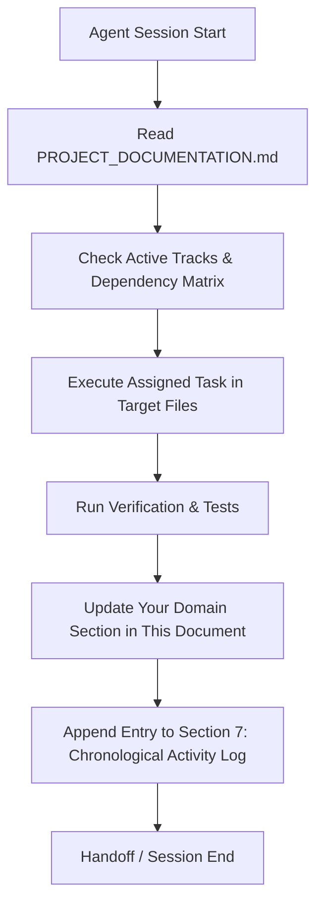
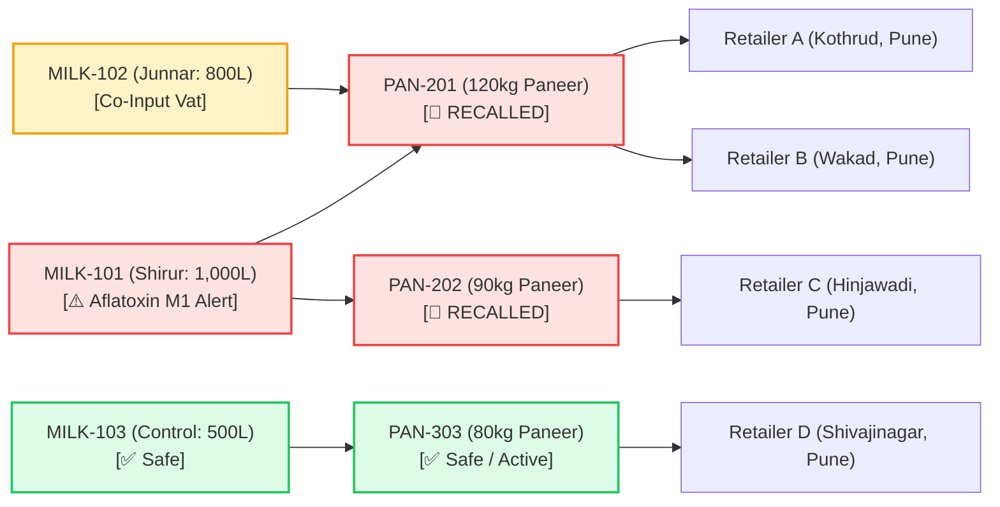
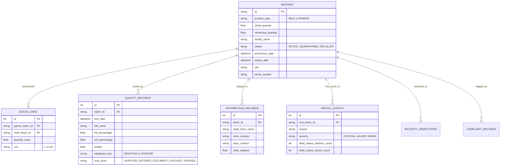

# FoodSync / DairyTrace — Living Project Documentation & Multi-Agent Ledger

> **Theme:** TRACE: Smart Food Traceability & Recall  
> **Event:** Tech4Food 2026 (CESA · ACM PCCOE Student Chapter · PCCOE, Pune)  
> **Team:** FoodSync (Aditya Kumar, Saloni Gupta, Vikash Kumar)  
> **Tagline:** *Every Batch Has a History. Every Recall Needs a Trace.*  
> **Document Purpose:** Single source of truth (SSOT) and living coordination record for all autonomous agents and human developers collaborating on this project.

---

## 1. Multi-Agent Collaboration Protocol & Operating Rules

All autonomous agents (Lead Architect, Frontend Engineer, QA/Compliance, AI Copilot, DevOps) operating on this repository **MUST** adhere to the following protocol:



### 1.1 Golden Rules for Agents
1. **Always Read Before Write:** Before modifying code, inspect this file to understand the current architecture, existing endpoints, shared schemas, and what previous agents have completed.
2. **Modular Ownership:** Maintain and update your designated Track section in **Section 4**. You may read other sections, but only update your own domain unless performing a cross-cutting refactor.
3. **Contract Integrity:** If your changes modify API routes, database models, or schemas, immediately update **Section 5 (Shared Contracts & System Specifications)**.
4. **Log Your Work:** Every agent session **MUST** end with a new entry in **Section 7 (Living Activity Log & Chronological Recording)** recording timestamps, modified files, test outputs, and next steps for subsequent agents.
5. **Preserve Invariants:** Do not overwrite or delete existing documentation, comments, or architectural rules established by other agents.
6. **Status Badges:** Use these standardized badges across your sections:
   - `🟢 OPERATIONAL / COMPLETE`
   - `🟡 IN PROGRESS / ACTIVE`
   - `🔵 PROPOSED / PLANNED`
   - `🔴 BLOCKED / BUG DETECTED`
   - `⚠️ REGRESSION WATCH`

---

## 2. High-Level Project Architecture & Overview

### 2.1 Problem Statement & Solution
In the Indian dairy supply chain, raw milk from hundreds of collection centres is pooled into vats to manufacture value-added dairy products like paneer, curd, and butter. 
* **The Problem:** When contamination (e.g., aflatoxin M1, antibiotic residues, or detergent adulterants) occurs, the transformation from milk to paneer creates an untracked downstream blast radius. Manufacturers either take days investigating paper manifests or issue massive blanket recalls destroying safe food.
* **The Solution:** **DairyTrace** provides millisecond BFS/DFS graph traversal for targeted recalls, immutable QR-linked batch passports, 3-tier evidence-verified lab records, and an AI-driven complaint & forensic report intake copilot.

### 2.2 System Architecture Diagram

```mermaid
graph TD
    subgraph ClientLayer["Frontend Layer (React 18 + Vite + Tailwind CSS)"]
        UI_Home["Landing Page / Role Selector"]
        UI_Dash["Operations Dashboard & Lineage Graph"]
        UI_Recall["Recall Center & Blast Radius Modal"]
        UI_Pass["Public Consumer Batch Passport (/passport/:id)"]
        UI_Insp["Inspector Hub & 3-Mode Safety Intake"]
        UI_QR["Dynamic QR Scanner / Allotment"]
    end

    subgraph APILayer["FastAPI Application Layer (:8000)"]
        R_Batch["/api/batches (Batch & Lineage CRUD)"]
        R_Qual["/api/quality (Lab Records & Tiers)"]
        R_Recall["/api/recall (Blast Radius Traversal)"]
        R_Insp["/api/inspections (Audits & Media)"]
        R_Comp["/api/complaints & /api/copilot (Forensics)"]
        R_Pub["/api/public (Passport & QR Delivery)"]
        R_Seed["/api/seed/tech4food (Pitch Demo Data)"]
    end

    subgraph CoreServices["Backend Engines & Services"]
        ENG_Graph["Recall Engine (BFS/DFS Traversal)"]
        ENG_QR["QR Service (SVG/PNG/Base64)"]
        ENG_FSSAI["FSSAI FoSCoS Dossier Exporter"]
        ENG_Copilot["Forensic Copilot (PDF/DOCX/Audio Intake)"]
    end

    subgraph DataLayer["Persistence Layer"]
        DB[("SQLite: dairytrace.db / PostgreSQL")]
        FS["Uploads / Static Sample Reports"]
    end

    ClientLayer --> APILayer
    APILayer --> CoreServices
    CoreServices --> DataLayer
```



### 2.3 The Core Transformation Graph (Reference Pitch Scenario)



---

## 3. Current System Health & Operational State

| Metric / Dimension | Current Value | Notes |
| :--- | :--- | :--- |
| **Backend Environment** | Python 3.14 (`.venv`) | FastAPI, SQLAlchemy 2.0, Pydantic V2 |
| **Frontend Environment** | Node.js 18+ / React 18 / Vite 5 | Tailwind CSS, Lucide React, Axios |
| **Database** | SQLite (`backend/dairytrace.db`) | Easily switched to PostgreSQL via `DATABASE_URL` |
| **Test Suite Status** | 🟢 **33 passed**, 🔴 **1 failing** | Total 34 tests collected across 5 test suites |
| **Active Known Blocker** | `test_complaints_copilot.py:150` | Missing `fat_percentage` in PDF parsed dict output |
| **Demo Pitch Ready** | 🟢 **Yes (Runbook validated)** | `DEMO_RUNBOOK.md` provides 3-minute rehearsed script |

---

## 4. Multi-Agent Tracks & Dedicated Update Sections

Each agent should navigate to their track below, review status, implement modifications, and update their section accordingly.

---

### Track 1: Backend Architecture & Core Services
* **Domain:** `backend/app/`, `backend/requirements.txt`
* **Assigned Agent:** Lead Backend Architect
* **Current Status:** 🟢 `OPERATIONAL`

#### 4.1.1 Responsibilities & Scopes
* Relational database models and migrations in `app/models.py`.
* Pydantic V2 schemas for input validation & serialization in `app/schemas.py`.
* Recursive Graph Recall Engine traversal (`app/services/recall_engine.py`).
* Dynamic QR Code generator for SVG, PNG, and Base64 payloads (`app/services/qr_service.py`).
* Core REST routers: `batches.py`, `quality.py`, `recall.py`, `public.py`.

#### 4.1.2 Recently Implemented Features (Oct 22, 2026)
* **Random Batch Initiation (`POST /api/batches/random`):** Generates realistic test milk collections or paneer batches with randomized facilities, volumes, SKUs, and serial numbers.
* **Auto-Designated QR Code Delivery:** Every new batch automatically generates a designated QR code (PNG, SVG, and base64) alongside its `/passport/{batch_id}` link.
* **Format-Specific QR Route (`GET /api/batches/{id}/qr?format=png|svg|json`):** Allows instant direct image rendering or JSON payload extraction.
* **Cycle Prevention in Lineage:** Enforces DAG (Directed Acyclic Graph) validation when linking batches via `would_create_cycle()`.

#### 4.1.3 Active Directives & Open Tasks for Backend Agent
- [x] Implement BFS/DFS blast radius calculation.
- [x] Create random batch generator endpoint.
- [x] Provide multi-format QR endpoints.
- [ ] Investigate and fix `complaint_copilot.py` extraction schema mismatch with `test_complaints_copilot.py`.
- [ ] Add Redis/in-memory caching for high-frequency QR passport lookups.

#### 4.1.4 Backend Agent Notes & Scratchpad
*(Backend Agent: Write your latest findings, architecture notes, or execution commands here)*
> The SQLite database uses foreign keys and cascade rules. When running tests, always use `isolated_test_client()` from `conftest.py` to prevent dirty state in `dairytrace.db`.

---

### Track 2: Frontend Engineering & UI/UX
* **Domain:** `frontend/`
* **Assigned Agent:** Senior Frontend & UI/UX Engineer
* **Current Status:** 🟢 `OPERATIONAL`

#### 4.2.1 Responsibilities & Scopes
* Modern responsive React dashboard utilizing Vite and Tailwind CSS.
* Batch operations, inventory tracking, and dynamic lineage visualization (`LineageGraph.jsx`).
* Emergency Recall Command Center (`RecallModal.jsx`) displaying blast radius stats.
* Consumer Transparency Passport (`ConsumerPassportPage.jsx`) reachable via `/passport/:id`.
* Inspector Hub (`InspectorHub.jsx`) with 3-tier safety reporting and QR scanner integration.
* API service bridge in `src/api.js`.

#### 4.2.2 Recently Implemented Features (Oct 22, 2026)
* **Integrated Batch Creation Modal (`BatchCreationModal.jsx`):** Allows 1-click "Random Batch Initiation" or custom batch creation with automatic live QR code preview.
* **Three-Tier Safety & Adulteration Form (`ThreeTierSafetyForm.jsx`):** Provides instant switching between Supplier-Entered, Document-Checked, and Verified trust tiers.
* **Interactive Lineage Tree:** Node-and-edge visualization rendering milk blending into paneer blocks with live status tinting (Green for Active, Amber for Quarantined, Red for Recalled).
* **Consumer Mobile Passport (`ConsumerPassportPage.jsx`):** Public-facing card with FSSAI badge, nutrition parameters, lab certification status, and origin farm details.

#### 4.2.3 Active Directives & Open Tasks for Frontend Agent
- [x] Operations dashboard with batch counts and inventory cards.
- [x] Recall modal with blast radius retailer contact sheet.
- [x] Mobile consumer passport view.
- [x] Random batch generator button in BatchCreationModal.
- [ ] Add direct print/download button for FSSAI PDF notice on the Recall Center modal.
- [ ] Polish audio recorder visual waveform animation in ComplaintModal.

#### 4.2.4 Frontend Agent Notes & Scratchpad
*(Frontend Agent: Write your latest UI updates, routing changes, or styling notes here)*
> Dev server starts via `npm run dev` in `frontend/` on `http://localhost:5173`. CORS is preconfigured on the backend to accept requests from this origin.

---

### Track 3: QA, Compliance & Test Automation
* **Domain:** `backend/tests/`, `backend/app/seed_data.py`, `backend/app/services/fssai_export.py`
* **Assigned Agent:** QA, Compliance & Test Automation Engineer
* **Current Status:** 🟡 `NEEDS ATTENTION (33/34 Tests Passing)`

#### 4.3.1 Responsibilities & Scopes
* Pytest test suite maintenance and coverage across all routers and services.
* Seed dataset integrity for the Tech4Food 2026 pitch scenario.
* FSSAI FoSCoS statutory compliance generation (JSON and printable HTML notices).
* Edge-case validation: Graph cycle detection, multi-parent blends, missing parameter tolerance.

#### 4.3.2 Test Suite Breakdown

| Test File | Test Count | Status | Description |
| :--- | :--- | :--- | :--- |
| `test_api.py` | 10 | 🟢 10/10 PASS | Validates all CRUD operations on batches, quality, and recall APIs. |
| `test_recall_engine.py` | 14 | 🟢 14/14 PASS | Validates BFS blast radius traversal, co-inputs, and unaffected controls. |
| `test_random_batch_and_qr.py` | 2 | 🟢 2/2 PASS | Validates random batch initiation and designated QR format delivery. |
| `test_inspections.py` | 2 | 🟢 2/2 PASS | Validates field auditor checklists and document uploads. |
| `test_complaints_copilot.py` | 6 | 🔴 5/6 PASS (1 FAIL) | Validates AI complaint intake, sample report parsing, and copilot endpoints. |

#### 4.3.3 Active Bug Report: `test_complaints_copilot.py` Failure
* **Failure Point:** Line 150 in `backend/tests/test_complaints_copilot.py`:
  ```python
  assert pdf_parsed["fat_percentage"] == 4.1
  # KeyError: 'fat_percentage'
  ```
* **Root Cause:** When `extract_text_from_upload()` parses sample PDF `NABL_Forensic_Report_MILK-101_Aflatoxin.pdf`, the extracted dictionary structure or key normalization in `merged_form` is omitting `fat_percentage`.
* **Fix Target:** `backend/app/services/complaint_copilot.py` inside the PDF regex parser or dictionary merger.

#### 4.3.4 Active Directives & Open Tasks for QA Agent
- [x] Build comprehensive recall engine test suite with multi-parent verification.
- [x] Create seed script matching pitch demo locations (Shirur, Junnar, Pune).
- [ ] Fix KeyError in `test_complaints_copilot.py` to restore 100% test pass rate (34/34).
- [ ] Add integration test verifying frontend build with `npm run build`.

#### 4.3.5 QA Agent Notes & Scratchpad
*(QA Agent: Write your test commands, assertion guidelines, and test results here)*
> To execute tests: `.\backend\.venv\Scripts\python.exe -m pytest backend/tests`

---

### Track 4: Multimodal AI & Forensic Copilot
* **Domain:** `backend/app/services/complaint_copilot.py`, `backend/app/routers/complaints.py`
* **Assigned Agent:** AI & Multimodal Intelligence Specialist
* **Current Status:** 🟡 `IN REFINEMENT`

#### 4.4.1 Responsibilities & Scopes
* AI Complaint Copilot for rapid intake of adulteration reports and consumer complaints.
* 3-Mode intake pipeline:
  1. **Mode 1 (Audio):** Simulates/handles voice speech-to-text with dairy keyword transcription and sentiment/urgency tagging.
  2. **Mode 2 (Visual/Photo):** Forensic image upload analysis for packaging tampering, curdling discoloration, or foreign matter.
  3. **Mode 3 (Document Forensics):** Ingestion and regex/LLM extraction of PDF, DOCX, TXT, and JSON NABL lab certificates.
* Sample reports catalog generation and auto-fill for frictionless hackathon demonstration.

#### 4.4.2 Active Directives & Open Tasks for AI Agent
- [x] Implement sample reports catalog with downloadable mock NABL certificates.
- [x] Build extraction pipeline for PDF, DOCX, TXT, JSON documents.
- [ ] Harmonize parsed output dictionary keys to ensure `fat_percentage`, `snf_percentage`, and `acidity_percentage` are consistently populated.
- [ ] Add automatic severity auto-escalation when adulterant status is `POSITIVE`.

#### 4.4.3 AI Agent Notes & Scratchpad
*(AI Agent: Write model integration details, prompt templates, and parsing notes here)*

---

### Track 5: DevOps, Infrastructure & Demo Management
* **Domain:** `DEMO_RUNBOOK.md`, `backend/dairytrace.db`, `package.json`
* **Assigned Agent:** DevOps & Pitch Coordinator
* **Current Status:** 🟢 `OPERATIONAL`

#### 4.5.1 Responsibilities & Scopes
* Local runtime environment, virtual environment, and dependency trees.
* Fast database resets and pitch demonstration rehearsals.
* Runbook coordination for the Tech4Food 2026 pitch day (Oct 23, 2026).

#### 4.5.2 Local Execution Quick-Start
```bash
# 1. Start Backend Server (Port 8000)
cd backend
.\.venv\Scripts\activate
uvicorn app.main:app --reload --port 8000

# 2. Start Frontend Dev Server (Port 5173)
cd frontend
npm run dev

# 3. Reset & Seed Official Pitch Dataset
curl -X POST http://localhost:8000/api/seed/tech4food
```

---

## 5. Shared Contracts & System Specifications

Any agent introducing or altering an endpoint or schema must document it in this directory.

### 5.1 REST API Endpoint Registry

| Method | Endpoint | Router | Description |
| :--- | :--- | :--- | :--- |
| `GET` | `/api/health` | `main.py` | System health check and team identity. |
| `POST` | `/api/seed/tech4food` | `main.py` | Wipes DB and seeds the official pitch scenario. |
| `GET` | `/api/batches` | `batches.py` | Lists batches with optional `product_type` and `status` filters. |
| `POST` | `/api/batches` | `batches.py` | Creates a new raw milk or paneer batch. |
| `POST` | `/api/batches/random` | `batches.py` | Initiates a randomized batch with quality tests and designated QR. |
| `GET` | `/api/batches/{id}` | `batches.py` | Retrieves batch details by ID. |
| `GET` | `/api/batches/{id}/qr` | `batches.py` | Returns QR code in PNG, SVG, or JSON base64 format. |
| `POST` | `/api/batches/link` | `batches.py` | Links parent milk batches to child paneer (cycle-checked). |
| `GET` | `/api/batches/{id}/lineage`| `batches.py` | Returns forward and backward genealogy graph nodes and edges. |
| `POST` | `/api/batches/distribution`| `batches.py` | Records retail distribution destination and units shipped. |
| `GET` | `/api/quality/{batch_id}` | `quality.py` | Lists quality and adulteration lab tests for a batch. |
| `POST` | `/api/quality` | `quality.py` | Adds a lab record with trust tier (`VERIFIED`, `DOCUMENT_CHECKED`, etc.). |
| `POST` | `/api/recall/simulate` | `recall.py` | Computes downstream blast radius for a batch without changing DB state. |
| `POST` | `/api/recall/trigger` | `recall.py` | Executes recall: marks batch `RECALLED`, co-inputs `QUARANTINED`. |
| `GET` | `/api/recall/events` | `recall.py` | Lists past recall history events. |
| `GET` | `/api/recall/{id}/fssai` | `recall.py` | Generates official FSSAI recall dossier (JSON or HTML). |
| `GET` | `/api/public/passport/{id}`| `public.py` | Public consumer transparency view without sensitive internal flags. |
| `POST` | `/api/complaints` | `complaints.py`| Submits a customer or retailer complaint. |
| `GET` | `/api/complaints/sample-reports` | `complaints.py` | Lists downloadable forensic sample reports. |
| `POST` | `/api/copilot/upload` | `complaints.py`| Parses uploaded PDF/DOCX/TXT/JSON report and returns merged form. |
| `POST` | `/api/copilot/process` | `complaints.py`| AI copilot multimodal processing (text, voice transcripts, photos). |
| `GET` | `/api/inspections` | `inspections.py`| Lists safety and quality inspections. |
| `POST` | `/api/inspections` | `inspections.py`| Creates a new auditor inspection record with optional media attachment. |

### 5.2 Database Entity Schema Overview



---

## 6. Cross-Agent Dependency & Handoff Matrix

| Upstream Producer (Track) | Artifact / Feature | Downstream Consumer (Track) | Status | Notes / Handoff Criteria |
| :--- | :--- | :--- | :--- | :--- |
| **Track 1 (Backend)** | `/api/batches/random` | **Track 2 (Frontend)** | 🟢 DELIVERED | Frontend uses this in `BatchCreationModal.jsx` for 1-click batch generation. |
| **Track 1 (Backend)** | Multi-format QR routes | **Track 2 (Frontend)** | 🟢 DELIVERED | Frontend displays SVG inline and offers PNG download. |
| **Track 4 (AI Copilot)**| Sample Report Upload | **Track 3 (QA)** | 🔴 BLOCKED | `test_complaints_copilot.py` expects `fat_percentage` in response dictionary. |
| **Track 1 & 4 (Backend)**| Fixed Report Parser | **Track 3 (QA)** | 🟡 IN PROGRESS | Need to align parser keys with `ComplaintCreate` and test expectations. |
| **Track 2 (Frontend)** | FSSAI Download Action | **Track 5 (Pitch/Demo)**| 🔵 PROPOSED | Add button to directly trigger printable HTML download on recall completion. |

---

## 7. Living Activity Log & Chronological Recording

Every collaborating agent must append an entry to this table upon completing work or discovering an issue.

| Timestamp (ISO) | Agent / Track | Action Taken | Files Modified | Test / Verification Status | Next Steps for Following Agent |
| :--- | :--- | :--- | :--- | :--- | :--- |
| **2026-10-18T16:30** | Lead Architect (Track 1) | Initialized core FastAPI models, SQLite DB, BFS Graph Recall Engine | `backend/app/main.py`, `models.py`, `services/recall_engine.py` | 🟢 Verified via initial unit tests | Connect REST API endpoints with Pydantic schemas. |
| **2026-10-18T18:40** | Frontend UI (Track 2) | Created React + Vite UI, LineageGraph, RecallModal, and ConsumerPassport | `frontend/src/` | 🟢 UI renders against mock API | Hook up live backend connection via Axios/Fetch. |
| **2026-10-18T19:30** | Compliance & QA (Track 3)| Created `seed_data.py`, FSSAI export service, and Pytest suites | `backend/tests/`, `services/fssai_export.py` | 🟢 28 tests passing | Expand copilot and random batch test cases. |
| **2026-10-22T19:08** | Core Architect (Track 1) | Implemented random batch initiation (`/api/batches/random`) & multi-format QR allotment | `backend/app/routers/batches.py`, `models.py`, `schemas.py`, `test_random_batch_and_qr.py` | 🟢 `test_random_batch_and_qr.py` passing | Integrate random batch button into UI modal. |
| **2026-10-22T19:15** | Frontend UI (Track 2) | Built `BatchCreationModal.jsx`, `ThreeTierSafetyForm.jsx`, updated `api.js` | `frontend/src/components/`, `frontend/src/api.js`, `frontend/src/App.jsx` | 🟢 Manual UI verification | Test full workflow from random batch creation to lineage inspection. |
| **2026-10-22T19:25** | System Documentation Agent | Established central project documentation, multi-agent protocol, and test diagnostics | `PROJECT_DOCUMENTATION.md` | 🟡 33/34 Pytest passing (Identified KeyError in copilot test) | Fix `test_complaints_copilot.py:150` in `complaint_copilot.py`. |

---

## 8. Agent Work Instructions: How to Record Your Next Update

When you complete your task as an autonomous agent, follow these exact steps to update this document:

1. **Update Your Track Status (Section 4):**
   * Change the status badge if your milestone is complete (e.g., from `🟡 IN PROGRESS` to `🟢 OPERATIONAL`).
   * Add completed items to your track's checklist `- [x]`.
   * Add any technical discoveries to your track's "Agent Notes & Scratchpad".

2. **Update the Dependency Matrix (Section 6):**
   * If you completed an artifact that unblocks another agent, set its status to `🟢 DELIVERED`.
   * If you found an unresolved blocker, set it to `🔴 BLOCKED` and describe the requirement.

3. **Append to the Chronological Activity Log (Section 7):**
   * Add a new row at the bottom of the table using the format:
     ```markdown
     | **YYYY-MM-DDTHH:MM** | Track Name / Agent ID | Summary of changes implemented | List of modified files | Test status (e.g. 34/34 passing) | Direct instructions for the next agent |
     ```

4. **Verify Test State:**
   * Run the test suite:
     ```powershell
     .\backend\.venv\Scripts\python.exe -m pytest backend/tests
     ```
   * Update the metric in **Section 3** if the passing test count changed.
